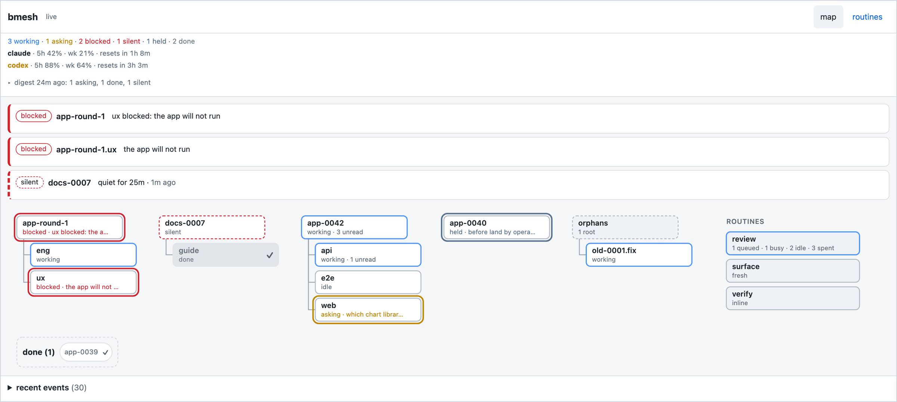

<p align="center">
  <picture>
    <source media="(prefers-color-scheme: dark)" srcset="docs/assets/banner-dark.svg">
    <source media="(prefers-color-scheme: light)" srcset="docs/assets/banner-light.svg">
    
  </picture>
</p>

<p align="center">
  <a href="https://github.com/rickdiculousli/buildermesh/tags"></a>
  <a href="go.mod"></a>
  <a href="docs/manual.md#several-boxes"></a>
  <a href="#quickstart-single-box"></a>
  <a href="LICENSE"></a>
</p>

<p align="center">
  <a href="#one-mesh-many-boxes"><b>Many boxes</b></a> &nbsp;·&nbsp;
  <a href="#proof-before-main"><b>Proof before main</b></a> &nbsp;·&nbsp;
  <a href="#how-you-drive-the-work"><b>Drive the work</b></a> &nbsp;·&nbsp;
  <a href="#quickstart-single-box"><b>Quickstart</b></a> &nbsp;·&nbsp;
  <a href="#all-commands-and-flags"><b>Commands</b></a> &nbsp;·&nbsp;
  <a href="docs/manual.md"><b>Manual</b></a>
</p>

<br>

**buildermesh** (`bmesh`) is one Go binary that runs Claude Code sessions on your own machines (boxes) and turns ideas into changes on `main`. You decide what gets built.

Agents write half-page specs; you pick the ones to build and decline the rest. A *lead* session builds a picked spec in its own git worktree, with *executor* sessions on branches under it. *Routines* run the repo's checks and record each result against a commit's exact files, and `bmesh land` refuses to land a tree those checks haven't passed.

## One mesh, many boxes

<h4 align="center">Three boxes, one workflow</h4>

<p align="center">
  <picture>
    <source media="(prefers-color-scheme: dark)" srcset="docs/assets/mesh-dark.svg">
    <source media="(prefers-color-scheme: light)" srcset="docs/assets/mesh-light.svg">
    
  </picture>
</p>

<h4 align="center">One box, same workflow</h4>

<p align="center">
  <picture>
    <source media="(prefers-color-scheme: dark)" srcset="docs/assets/mesh-one-dark.svg">
    <source media="(prefers-color-scheme: light)" srcset="docs/assets/mesh-one-light.svg">
    
  </picture>
</p>

- **One hub.** `bmesh hub` runs NATS, a message server, inside the binary on an always-on box, over a tailnet such as Tailscale. Boxes share one token; nothing else is installed. A single box runs no `bmesh hub`: its `bmesh serve` embeds the hub.
- **bmesh on every box.** Only `bmesh` talks to the hub: `bmesh serve`, the daemon, always on, which wakes quiet leads, lands what its leads finished, runs routines, sends phone notifications and draws the map; and the `bmesh` commands sessions run. A box set to update itself installs each bmesh release; on others, each session opens with a line to run `bmesh update`.
- **Signed jobs.** Boxes joined with `bmesh init --hosts` share a signed roster, and every job between them is signed and checked. The signing and approval keys sit where no agent can read them (on macOS, behind the Keychain password dialog). A secure box holds a move of a repo its sessions load plugins from until you approve it there.

Each picture below plays one of the demo's steps on its own, on a loop. &nbsp;**Grey** lights a command, &nbsp;**teal** a message.

**Every box builds.** Each box runs its own leads and executors, each in its own git worktree, all at once.

<p align="center">
  <picture>
    <source media="(prefers-color-scheme: dark)" srcset="docs/assets/mesh-build-dark.svg">
    <source media="(prefers-color-scheme: light)" srcset="docs/assets/mesh-build-light.svg">
    
  </picture>
</p>

**A coordinator keeps leads in step.** The session that started the builds starts a lead on each box in turn (over ssh on the other boxes), then follows their events through the hub. On your word it holds a lead (`bmesh hold`; with `--gate now` it stops at its next inbox read, as task-1 does here) until another has landed, then releases it (`bmesh unhold`), and the held lead's `bmesh serve` wakes it.

<p align="center">
  <picture>
    <source media="(prefers-color-scheme: dark)" srcset="docs/assets/mesh-coordinate-dark.svg">
    <source media="(prefers-color-scheme: light)" srcset="docs/assets/mesh-coordinate-light.svg">
    
  </picture>
</p>

**A check goes to the box that can run it.** A check that runs apart from the lead, like the review, is queued once for every box that runs it, so a free box takes it. One that needs macOS, like task-1's `xcode` here, waits on the hub until a Mac's `bmesh serve` takes it; the result comes back to the lead.

<p align="center">
  <picture>
    <source media="(prefers-color-scheme: dark)" srcset="docs/assets/mesh-route-dark.svg">
    <source media="(prefers-color-scheme: light)" srcset="docs/assets/mesh-route-light.svg">
    
  </picture>
</p>

**Push notifications.** When a lead asks, is blocked or is done, its event goes through the hub to `bmesh serve` with an [ntfy](https://ntfy.sh) topic set (here, hub-box's), which pushes it to your phone, once.

<p align="center">
  <picture>
    <source media="(prefers-color-scheme: dark)" srcset="docs/assets/mesh-push-dark.svg">
    <source media="(prefers-color-scheme: light)" srcset="docs/assets/mesh-push-light.svg">
    
  </picture>
</p>

**Every box levels.** A lead's land moves its own box's checkout. `bmesh sync` levels this box's checkout with origin and sends a `level` job to every other box that has the repo (the box that landed is already level, so the picture leaves its job out); each fast-forwards its own unless it's dirty or diverged, and a secure box holds a plugin change for your approval. A laptop that wakes takes the jobs it missed, in order; a job waits on the hub for a day.

<p align="center">
  <picture>
    <source media="(prefers-color-scheme: dark)" srcset="docs/assets/mesh-level-dark.svg">
    <source media="(prefers-color-scheme: light)" srcset="docs/assets/mesh-level-light.svg">
    
  </picture>
</p>

**All of this works on one box too.** With no other boxes, `bmesh serve` embeds the hub, and the same commands drive the same flow. `[runner] max_leads` caps how many leads run at once (`bmesh build` refuses past it), so here the coordinator starts a third lead once one of the first two has landed, and holds it until the lead it depends on has landed too.

<p align="center">
  <picture>
    <source media="(prefers-color-scheme: dark)" srcset="docs/assets/mesh-one-dark.svg">
    <source media="(prefers-color-scheme: light)" srcset="docs/assets/mesh-one-light.svg">
    
  </picture>
</p>

## Proof before main

<p align="center">
  
</p>

`bmesh land` runs `verify` first, queues the Opus review the spec's size calls for when the branch has none and waits for it, then takes the land lease, runs `verify` on the rebased tree and carries the review across the rebase when the diff is unchanged (a changed diff gets a new review, which land queues and waits for), then rewords the lead's last commit to carry the results as two trailers, changing no file:

```
Spec: 012
Verified: review ok t:3f2a9c1e m:claude-opus-5-5 c:81d0b7a4; verify ok t:3f2a9c1e
```

`t:` is the landed tree, `c:` the tree the review ran on before the rebase. `bmesh done` refuses until that commit is on `origin/main` with a recorded result for every entry.

## How you drive the work

<p align="center">
  <picture>
    <source media="(prefers-color-scheme: dark)" srcset="docs/assets/lifecycle-dark.svg">
    <source media="(prefers-color-scheme: light)" srcset="docs/assets/lifecycle-light.svg">
    
  </picture>
</p>

1. **Propose.** `bmesh ideate app` starts one thread that reads the repo, and runs the app when its row lists surfaces, and brings back three to six ideas ranked in one list, landing a spec on `main` for each one sized M or larger and pitching a smaller one as a line (a second thread runs the UI/UX part only when the app runs on another box), and with an [ntfy](https://ntfy.sh) topic set the list reaches your phone.
2. **Choose.** Picking is building: `bmesh build app 012 014` checks that `main` passes its verify commands and starts a lead for each, with `--context` for your words to them. A spec you don't want you decline with `bmesh spec set --repo app --id 013 --status rejected --field reason="covered by 012" --land`, or shelve with `--status later`; both land on `main`.
3. **Build.** Each lead builds its spec in its own worktree. Nothing is recorded on `main`, where the spec reads `proposed` until its lead lands it `done`.
4. **Verify.** Routines run `verify` (the repo's tests) and, for larger changes, `review` (Opus, in a session that never saw the change).
5. **Land.** `bmesh land` verifies, queues the review the spec's size calls for and waits for it, then rebases onto `origin/main` (resolving the conflicts a rule can), requires a result for the tree it lands, rewords the last commit to carry the `Spec:` and `Verified:` trailers and fast-forwards `main`; the lead set the spec `done` on its branch, so it lands with the code. It waits out what clears by itself (a review running, `main` moving, someone's unpushed `main`, another lead landing) and stops only for what needs the lead. A lead usually hands this to its box's daemon instead: it runs `bmesh ready --text "<done line>"` and ends its turn, its state reads `landing`, and the daemon runs `land` and `done` for it. The daemon wakes the lead only when land refuses (a conflict, a failing check or review), and once at the end for its closing line. A hold waits for the release without waking it, and a message withdraws the request and wakes it.

A lead reports problems outside its spec as feedback. When a batch started from a chat is done, the plugin's `work` skill makes the quick fixes itself without asking you, writes the rest up as proposed specs for your review and tags the next version with `bmesh release`. In a chat, say "proposals for app", "build 1 and 3", "decline 2" or "what's building".

A fix or a tweak skips all of this. Say "fix the login button in app", or just what's wrong with it, and the plugin's `work` skill makes the change in the chat, runs `verify`, reviews its own diff with [ponytail](https://github.com/DietrichGebert/ponytail)'s review (plus an Opus review when it crosses modules), and pushes it to `main`: no spec, no lead. A change that alters an interface others depend on, it plans in five lines for your ok first. Say you're QA-ing (or "hold off") and it lists each thing you report with its cause and fix, changing nothing until you say "go" or "fix 1 and 3".

## Quickstart (single box)

You need Go 1.26 or later, git, Claude Code (`claude` on your `PATH`, signed in) and a repo with a `main` branch.

```sh
go install github.com/rickdiculousli/buildermesh/cmd/bmesh@latest
cd ~/repos/your-repo
bmesh init      # press Enter at every prompt
```

`bmesh init` also installs the plugin: the binary carries its skills and writes them to a dir of its own, which it makes Claude Code's `buildermesh` marketplace (`claude plugin list` shows `buildermesh@buildermesh` read from it). On a box set up already, `bmesh plugin --install` does the same. The skills move with the binary: `bmesh update` (or the daemon's own update) brings both.

Add the repo's verify commands to the row `bmesh init` wrote in `repos.toml` (it prints the path):

```toml
[repos.your-repo]
# the keys init wrote stay as they are
verify = ["go vet ./...", "go test ./..."]
```

```sh
bmesh scaffold your-repo    # commit and push what it writes
```

`scaffold` writes AGENTS.md's shared sections, the `core` engineering rules and `.bmesh/routines/verify.toml`, the routine that runs those commands; in a chat, "scaffold your-repo" asks which [rule sets](docs/manual.md#rule-sets) the repo gets first.

**That is enough for a quick fix, with no `bmesh serve` running.** In a chat in the repo, say what to change ("fix the typo in the footer"): the `work` skill makes the change in a worktree of its own, commits it, runs `bmesh routine run verify`, reviews the diff and pushes it to `main`. With no `bmesh serve` there is no hub to keep the result in, so `routine run` runs the checks, records nothing and says so:

```
verify ok t:3f2a9c1e (not recorded: no hub at 127.0.0.1:4222)
```

`scaffold`, `repos` (and `repos show`), `spec` (all but `spec verified`; `spec next-id` then claims nothing), `setup`, `config check`, `update` and `version` need no `bmesh serve` either.

**What needs `bmesh serve`.** On a single box it runs the hub as well as the daemon. Leads (`build`), proposal rounds (`ideate`), holds, recorded results (`routine run`'s record, `routine queue`, `result`, `spec verified`), `land`, `release`, `mesh-status` and the map all need it. Start it when you want them:

```sh
bmesh serve                 # keep it running
bmesh ideate your-repo      # your first proposal round
```

Several boxes are the step after: [Quickstart (mesh)](#quickstart-mesh).

## Quickstart (mesh)

One always-on box runs the hub; the other boxes reach it over a tailnet such as Tailscale. Install `bmesh` and the plugin on every box as above, then:

1. On the hub box:

   ```sh
   bmesh init --role hub --service    # Enter at every prompt; enable the two services it prints
   ```

2. Copy the hub's token file (`nats.token` in its config dir) into each other box's config dir.
3. On each other box:

   ```sh
   bmesh init --hub nats://<hub tailnet ip>:4222 --token-file <config dir>/nats.token --service    # enable the service it prints
   # a laptop that sleeps: bmesh init --role leaf --service, with nats://<hub tailnet ip>:7422 at the prompt; enable the two services it prints
   ```

4. Optional, so boxes can act on each other: join them to a roster. On the box you type at, run `bmesh init --hosts --admin`. For each other box, run `bmesh hosts invite <its host name>` on the admin box, then `bmesh init --hosts` on that box and paste the code. Restart `bmesh serve` on each box after its `init --hosts`.

## Monitor the mesh

<p align="center">
  <picture>
    <source media="(prefers-color-scheme: dark)" srcset="docs/assets/map-dark.png">
    <source media="(prefers-color-scheme: light)" srcset="docs/assets/map-light.png">
    
  </picture>
</p>

`bmesh serve` draws the mesh live at `http://127.0.0.1:3774/`: leads with their executors, rounds with their engineers, each check with its queue, and at the top what needs you: a session that is blocked, asking or silent. A lead its daemon is landing, or one held at a gate, is drawn calm and never in that band, and a quiet `working` lead is the only kind called silent.

## All commands and flags

> **Honestly, you can mostly skip this.** With the plugin installed, just ask your agent to run the mesh for you: "proposals for app", "build 012 in app", "fix the typo in app's footer", "what's building", "sync my repos". The skills know these commands so you don't have to. This list is here for when you're curious or something needs a closer look.

`--config FILE`, `--node PATH` and `--json` go before or after any command ([Synopsis](docs/manual.md#synopsis)). Each command links to its section of the [manual](docs/manual.md).

**Setup and updates**

| Command | Flags |
|---|---|
| [`bmesh init`](docs/manual.md#bmesh-init) | `[--service] [--force] [--role hub\|leaf\|client] [--hub URL] [--token-file F] [--runner K] [--no-repo]` |
| [`bmesh init --hosts`](docs/manual.md#bmesh-init) | `[--admin]` |
| [`bmesh serve`](docs/manual.md#bmesh-serve) | `[--listen ADDR] [--restart [--detach]]` |
| [`bmesh hub`](docs/manual.md#bmesh-hub) |  |
| [`bmesh config check`](docs/manual.md#bmesh-config-check) |  |
| [`bmesh t3 login`](docs/manual.md#bmesh-t3-login) | `[--server URL] [--callback-port 52299] [--timeout D] · --status` |
| [`bmesh version`](docs/manual.md#bmesh-version) |  |
| [`bmesh help`](docs/manual.md#synopsis) |  |
| [`bmesh update`](docs/manual.md#bmesh-update) | `[--repo R] [--latest] [--answer KEY=VALUE]... [--defaults] [--apply [--yes]]` |
| [`bmesh update --plan`](docs/manual.md#bmesh-update) | `[--json]` |
| [`bmesh update --walk`](docs/manual.md#bmesh-update) | `--from REV [--to REV] [--dir D] [--before-swap]` |
| [`bmesh update --notice`](docs/manual.md#bmesh-update) |  |
| [`bmesh plugin`](docs/manual.md#bmesh-plugin) | `[--install]` |

**Proposals and builds**

| Command | Flags |
|---|---|
| [`bmesh ideate <repo>`](docs/manual.md#bmesh-ideate) | `[--idea] [--model M] [--effort E] [--context <text\|->] [--force]` |
| [`bmesh spec list`](docs/manual.md#bmesh-spec-list) | `[--repo R] [--status S] [--json]` |
| [`bmesh spec next-id`](docs/manual.md#bmesh-spec-next-id) | `[--repo R] [--count N] [--peek]` |
| [`bmesh spec set`](docs/manual.md#bmesh-spec-set) | `--id NNN[,NNN...] --status S [--repo R] [--from A,B] [--field K=V]... [--land]` |
| [`bmesh spec template`](docs/manual.md#bmesh-spec-template) | `[--repo R]` |
| [`bmesh spec steps [<NNN>]`](docs/manual.md#bmesh-spec-steps) | `[--repo R] [--tick N,N [--note W] \| --check [--wait D]]` |
| [`bmesh spec verified`](docs/manual.md#bmesh-spec-verified) | `[--commit C]` |
| [`bmesh build <repo> <NNN> [<NNN>...]`](docs/manual.md#bmesh-build) | `[--model M] [--effort E] [--path P] [--family F] [--hold land\|now] [--context <text\|->] [--force]` |
| [`bmesh lead start`](docs/manual.md#bmesh-lead-start) | `--repo R --spec NNN --brief FILE [--model M] [--effort E] [--title T] [--path P]` |
| [`bmesh hold <path>\|--family F`](docs/manual.md#bmesh-hold-unhold-held) | `[--gate land\|now] --text T` |
| [`bmesh unhold <path>\|--family F`](docs/manual.md#bmesh-hold-unhold-held) | `[--text T]` |
| [`bmesh held`](docs/manual.md#bmesh-hold-unhold-held) |  |
| [`bmesh feedback "<text>"`](docs/manual.md#bmesh-feedback) | `[--repo R] [--where <file\|command>] [--fixed SHA]` |
| [`bmesh feedback list <family>\|--repo R`](docs/manual.md#bmesh-feedback) | `[--json]` |
| [`bmesh feedback drain <family>`](docs/manual.md#bmesh-feedback) | `[--through SEQ]` |
| [`bmesh feedback drain`](docs/manual.md#bmesh-feedback) | `--seq SEQ[,SEQ...]` |
| [`bmesh fix`](docs/manual.md#bmesh-fix) | `[--model M] [--effort E]` |
| [`bmesh release <repo>`](docs/manual.md#bmesh-release) | `[--minor\|--patch] [--dry-run]` |
| [`bmesh scaffold <repo>`](docs/manual.md#bmesh-scaffold) | `[--check]` |

**Nodes**

| Command | Flags |
|---|---|
| [`bmesh whoami`](docs/manual.md#bmesh-whoami) |  |
| [`bmesh context`](docs/manual.md#bmesh-context) | `[--json]` |
| [`bmesh started\|progress\|blocked\|ask`](docs/manual.md#bmesh-started-progress-blocked-ask-done) | `[--text T]` |
| [`bmesh done`](docs/manual.md#bmesh-started-progress-blocked-ask-done) | `--commit SHA [--text T]` |
| [`bmesh send <path> <text\|->`](docs/manual.md#bmesh-send) |  |
| [`bmesh inbox`](docs/manual.md#bmesh-inbox) | `[--peek] [--json]` |
| [`bmesh thread-status [<path>]`](docs/manual.md#bmesh-thread-status) | `[--json]` |
| [`bmesh mesh-status`](docs/manual.md#bmesh-mesh-status) | `[--all] [--json]` |
| [`bmesh watch`](docs/manual.md#bmesh-watch) | `--nodes a,b [--since T] [--timeout D]` |
| [`bmesh executor new`](docs/manual.md#bmesh-executor-new) | `--name N [--base REF] [--model M] [--json]` |
| [`bmesh executor list`](docs/manual.md#bmesh-executor-list) | `[--json]` |
| [`bmesh executor remove <name>`](docs/manual.md#bmesh-executor-remove) | `[--force]` |
| [`bmesh node forget <path>`](docs/manual.md#bmesh-node-forget) | `[--worktree \| --wipe [--dry-run]] [--wait 30s]` |
| [`bmesh node stop <path>`](docs/manual.md#bmesh-node-stop) | `[--text T] [--wait 30s]` |

**Checks and landing**

| Command | Flags |
|---|---|
| [`bmesh routine list`](docs/manual.md#bmesh-routine-list) | `[--json]` |
| [`bmesh routine status [<kind>]`](docs/manual.md#bmesh-routine-status) | `[--json]` |
| [`bmesh routine queue <kind>`](docs/manual.md#bmesh-routine-queue) | `[--commit C] [--model M] [--effort E] [--go] [--rerun] [--again] [--text T] [-- args...]` |
| [`bmesh routine go <kind>`](docs/manual.md#bmesh-routine-go) |  |
| [`bmesh routine wait <job id>`](docs/manual.md#bmesh-routine-wait) | `[--timeout D]` |
| [`bmesh routine run <kind>`](docs/manual.md#bmesh-routine-run) | `[--commit HEAD] [--model M] [--effort E] [--here] [--rerun] [--text T] [-- args...]` |
| [`bmesh result find <kind>`](docs/manual.md#bmesh-result-find) | `[--commit C] [--model M] [--json] [-- args...]` |
| [`bmesh result record <kind>`](docs/manual.md#bmesh-result-record) | `--ok\|--fail [--commit C] [--model M [--base B]] [--output FILE\|-] [-- args...]` |
| [`bmesh lock-lease acquire <slot>`](docs/manual.md#bmesh-lock-lease) | `[--ttl D]` |
| [`bmesh lock-lease renew <key>`](docs/manual.md#bmesh-lock-lease) | `[--ttl D]` |
| [`bmesh lock-lease release <key>`](docs/manual.md#bmesh-lock-lease) |  |
| [`bmesh lock-lease run <slot>`](docs/manual.md#bmesh-lock-lease) | `[--ttl D] -- <cmd...>` |
| [`bmesh setup`](docs/manual.md#bmesh-setup) | `[--check] [--force]` |
| [`bmesh land`](docs/manual.md#bmesh-land) | `[--spec NNN] [--size XS\|S\|M\|L] [--ttl D] [--wait D]` |
| [`bmesh ready`](docs/manual.md#bmesh-ready) | `--text "<done line>" [--size XS\|S\|M\|L] \| --cancel` |

**Boxes**

| Command | Flags |
|---|---|
| [`bmesh hosts`](docs/manual.md#bmesh-hosts) | `[--json]` |
| [`bmesh hosts --here`](docs/manual.md#bmesh-hosts---here) |  |
| [`bmesh hosts --notes`](docs/manual.md#bmesh-hosts---notes) | `[--json]` |
| [`bmesh hosts invite <name>`](docs/manual.md#bmesh-hosts-invite) | `[--secure] [--accept a,b] [--replace]` |
| [`bmesh hosts set <name>`](docs/manual.md#bmesh-hosts-set) | `[--secure=true\|false] [--accept a,b]` |
| [`bmesh hosts revoke <name>`](docs/manual.md#bmesh-hosts-revoke) |  |
| [`bmesh hosts ping [<host>]`](docs/manual.md#bmesh-hosts-ping) | `[--wait D]` |
| [`bmesh hosts replies`](docs/manual.md#bmesh-hosts-replies) | `[--json]` |
| [`bmesh hosts held`](docs/manual.md#bmesh-hosts-held) | `[--json]` |
| [`bmesh hosts approve <id>`](docs/manual.md#bmesh-hosts-approve) |  |
| [`bmesh hosts deny <id>`](docs/manual.md#bmesh-hosts-deny) |  |
| [`bmesh sync`](docs/manual.md#bmesh-sync) | `[--repo R \| --all] [--wait 30s]` |
| [`bmesh prune`](docs/manual.md#bmesh-prune) | `[--repo R \| --all] [--apply] [--wait 30s]` |
| [`bmesh repos`](docs/manual.md#bmesh-repos) | `[--json]` |
| [`bmesh repos show <name>`](docs/manual.md#bmesh-repos-show) | `[--json]` |
| [`bmesh repos publish`](docs/manual.md#bmesh-repos-publish) |  |
| [`bmesh repos propose`](docs/manual.md#bmesh-repos-propose) | `[--wait 30s]` |
| [`bmesh repos remove <name>`](docs/manual.md#bmesh-repos-remove) | `[--checkouts [--ignored-ok]] [--apply] [--wait 1m]` |

**Add-ons** (off unless `config.toml`'s `[addons] enable` lists them; `bmesh serve` runs them)

| Add-on | Config |
|---|---|
| [`t3-done`](docs/manual.md#t3-done): pushes when a T3 thread you started here is done, failed or asking | `[addons] enable = ["t3-done"]` · `[addons.t3-done] ntfy = URL [every = 5s] [min_busy = 5m]` |

## What's inside

- **`bmesh`**: the CLI, daemon, map server and NATS hub in one binary.
- **Runners**: `t3` (a T3 Code thread), `claude` (headless `claude -p` turns) or `tmux` runs each session.
- **The plugin**: nine Claude Code skills, carried by the binary: five for your chat, with `work` taking whatever you bring, and four that the sessions bmesh starts follow.
- **Specs**: `docs/proposals/NNN-slug.md` in each repo, with status, builder, merged commit and `verified` line in the frontmatter.

The [manual](docs/manual.md) covers every command, flag, config key, output and refusal, and the concepts behind them. [Internals](docs/internals.md) covers NATS subjects, buckets, record shapes and signing.

## Build and test

```sh
go build ./cmd/bmesh
TMPDIR=$HOME/.cache/bmesh-scratch/tmp go test -count=1 ./...
```

Tests refuse `/tmp`, so `TMPDIR` points elsewhere. The seeded mesh (`scripts/seed.sh`), the map's browser check (`node scripts/check.mjs`) and the UI-change check are in the manual's [Testing](docs/manual.md#testing) section.

## License

MIT.

<br>

<p align="center"></p>
