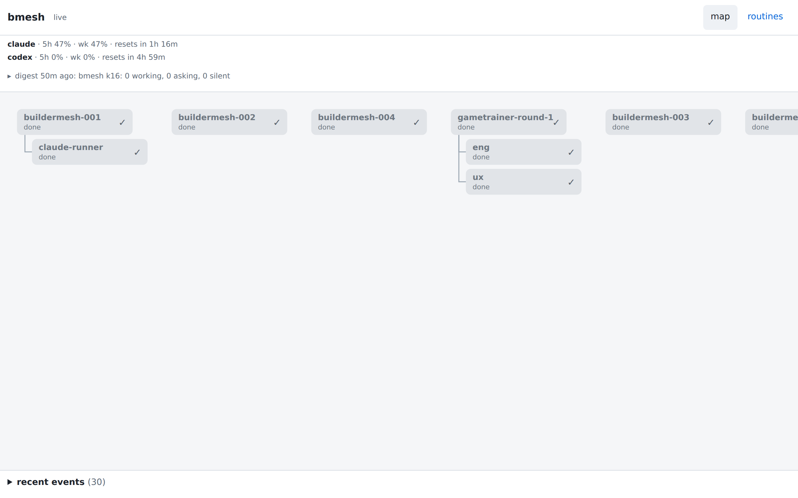
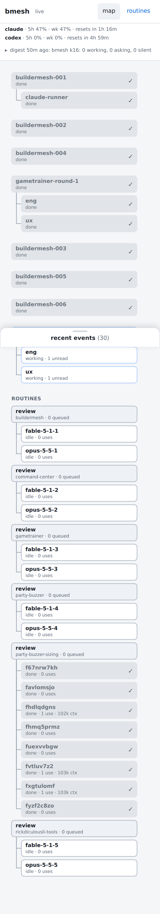
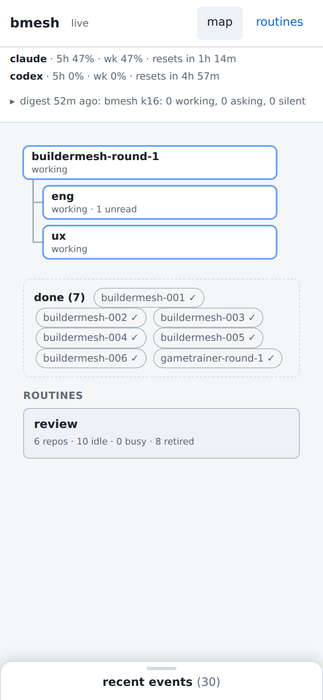

## Opportunity
The map answers "what is the mesh doing now", and today that answer is off-screen on both viewports. `layout()` in `map.js` places lead blocks in `started_at` order, so the finished ones come first and the one live lead last.

At 1280x800 the `?check=1` title reads `SCROLLS scrollWidth=2136`: the first screen is five grey `done` blocks and part of a sixth, `buildermesh-round-1` (the only `working` lead) starts at about x=1600, and the routines column at about x=1870, both off the right edge.

At 390x844 the blocks stack. The working round is the eighth block, and its top edge sits under the closed drawer, so the first paint is done boxes and check marks only.

The map draws every lead ever registered: a node "stays in `bm-nodes` for the map" (README, Executors), so the done set only grows and the live set never gets the first screen back.

## Proposal
Order and fold; no new data.

In:
- Blocks run in need order: `blocked`, `asking`, `silent`, then `working`, then `idle` (no state yet), then `done`; ties keep `started_at` order so a running round's layout stays stable. The orphans block keeps its place after the leads.
- When at least one lead is live (any state but `done`) and at least one is `done`, the done leads leave the tree and fold into a shelf under the live blocks: a row of chips (`buildermesh-001 ✓`, newest first), each a link to its lead page, headed `done (7)`. With no live lead, done leads draw as trees, as now. A lead's state is its own: a live lead whose children are all done still draws as a tree.
- A `done` event moves the lead to the shelf on the redraw the map already does for `done`.
- Routines keep their column (last on the phone); 014 is about them.

Out: hiding done leads, a filter UI, any change to `/api/tree` or the daemon. 013 adds a band for asks above the map; this spec only orders the map itself.

Judge: fable, because what reads as "live" at a glance is a weight and spacing call the spec can't pin.

## What you'll see
On the phone the working round and its two engineers fill the first screen, the finished leads are a line of chips beneath, routines follow. On the desktop the live blocks start at the left and a mesh of this size no longer scrolls sideways. The mock below shows the shelf; its routines box is 014's, not this spec's.

## Verification
The verify commands pass (`web_test.go` covers the served assets and API, not the browser). The browser check runs against the branch's own binary (`go run ./cmd/bmesh serve` with a test config on another port, since the daemon on 3774 is the installed `main`) with a headless Chromium script that loads the page at the viewport and prints `document.title` for `?check=1` at 390x844 and 1280x800: the title reads `ok` (no sideways scroll) for this mesh, and the first `.st-working` box's top is inside the viewport on first paint. README gains a `### Map` section after `### Pushes` (there is none today) that states the ordering and the shelf.

## Risks and the alternative considered
Other ways to carry the job: (a) sort only, keeping done leads as full blocks: the phone still scrolls through seven done blocks before routines; (b) hide done leads behind a toggle: loses the click-through to a finished lead's spec and timeline, used after a push; (c) a history page: a second place to look. The shelf keeps every lead reachable on one screen.

The case that users don't feel it: with one or two leads the current order is fine. The screenshots show eight leads after one day, and the count only grows.

## Needs from the operator
