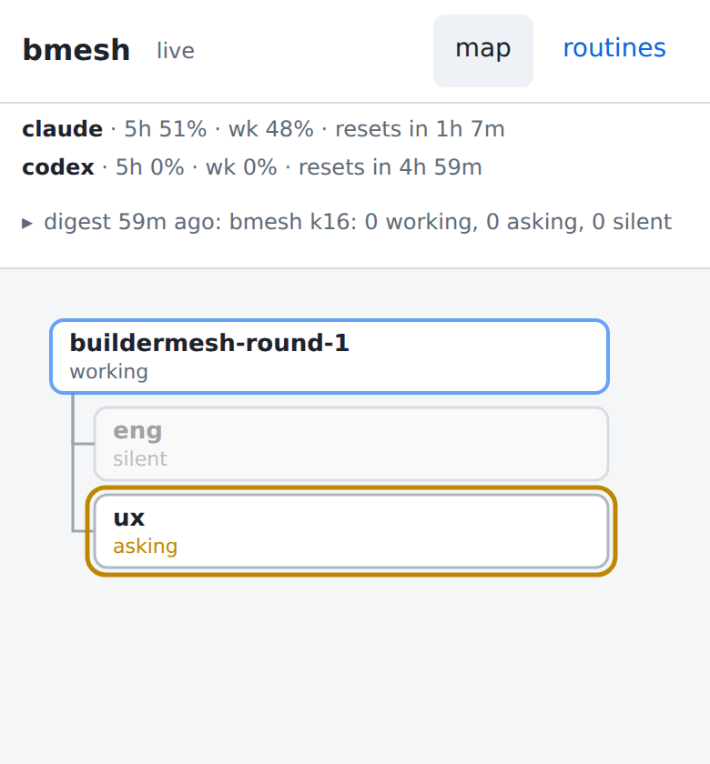
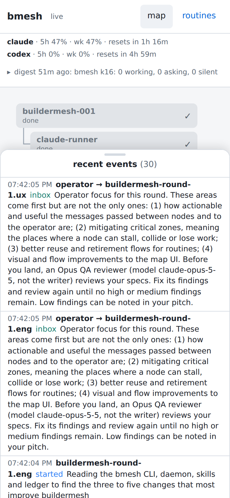
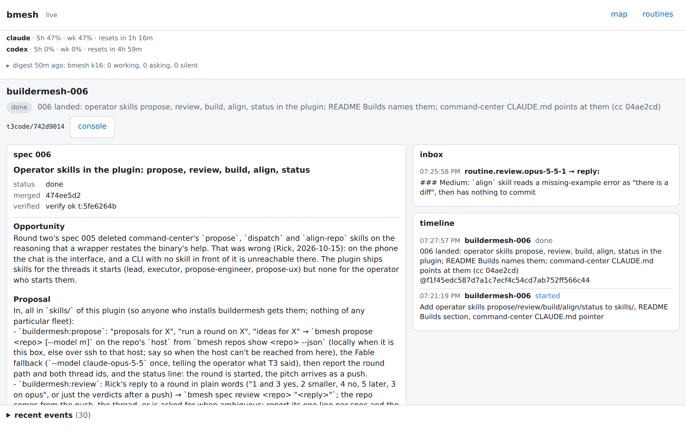

## Opportunity
A lead's `ask` and `blocked` are the two high-priority pushes to the operator's phone, and the map is where the push's `Click` lands (`<map_url>#/lead/<path>`, README, Pushes). On the map an ask is a yellow ring and the word `asking` in 11 px; the question is nowhere, since a node's second line is `state · N unread`. A `silent` node, the daemon's "may be stuck" verdict, draws at 40 % opacity (`.st-silent { opacity: .4 }`, `map.css`), fainter than `done`. Below, the current styling with the `ux` node set to `asking` and `eng` to `silent` by script:

The words do reach the recent-events drawer and the lead page, and there a long inbox message fills a phone screen, twice (the operator's round brief, sent to `.eng` and `.ux`):

So the operator on the phone opens the map and still taps into each lead to learn what it wants; the lead page then shows the question as a `muted` span after the badge.

## Proposal
In:
- A "needs you" band between the strip (015's summary row, when built) and the map, shown only when a lead, round or engineer is `asking`, `blocked` or `silent`: one row per node with its state badge, path and `state.text` (the ask or block text; for silent the daemon already writes "quiet for 25m"), clamped to three lines with the rest on tap. The row links to the lead page. The band drops the row on the node's next `progress`, `started` or `done`.
- On the map an `asking` or `blocked` box's second line is the state followed by as much of `state.text` as `room()` leaves, instead of the unread count. `silent` boxes draw at full opacity with a dashed stroke in the `blocked` colour.
- Drawer rows and the lead page's inbox and timeline rows clamp to three lines, expanding on tap. The lead page's timeline rows drop the lead's own path prefix from child paths (`eng`, not `buildermesh-round-1.eng`).

Out: replying from the map (the thread is for that; the `console` link goes there), sound, any new event or API field (`state.text` is already in `/api/tree`).

Judge: fable, because the band must be loud enough to stop a thumb and quiet enough to live under the strip, and that balance is taste.

## What you'll see
A lead asks; the push opens the map and the top of the page reads, in one row, who asks and what. A quiet node is outlined, not faded. The phone drawer shows about ten events per screen instead of two.

## Verification
The verify commands pass. The browser check is the `surface` kind against `?check=1` at 390x844 with a node set `asking` (by `bmesh ask` on a test node, or by script as in the screenshot above): the band is present, holds the text, and the self-check's `minTap` stays at 40 or more with the band's rows counted as tap targets. README's Map paragraph (added by 012, or here) names the band and the silent styling.

## Risks and the alternative considered
Alternatives: (a) text on the node box only: a 184 px box fits about nineteen characters after the state, a teaser, not the ask; (b) a count badge on the nav: tells you something waits, not what; (c) rely on the push body: gone once dismissed, and a second ask overwrites it in the eye.

The case that users don't feel it: a mesh with one lead and an operator at a desk sees the ring and clicks. `map.css` builds the phone layout on purpose (the 699 px breakpoint, the bottom sheet) and spec 006 records that "on the phone the chat is the interface"; the map has to carry the words there.

## Needs from the operator
