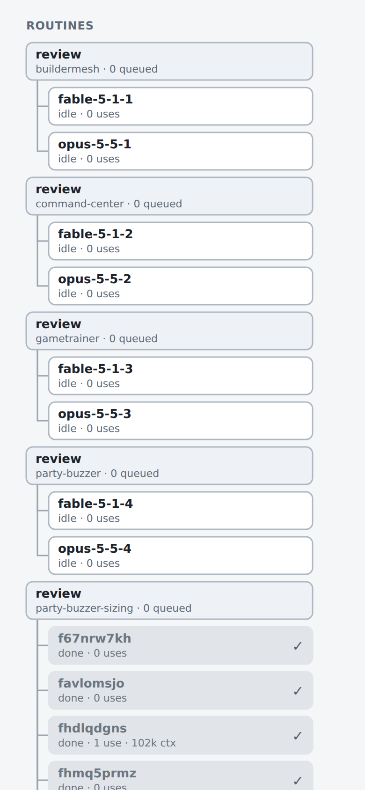
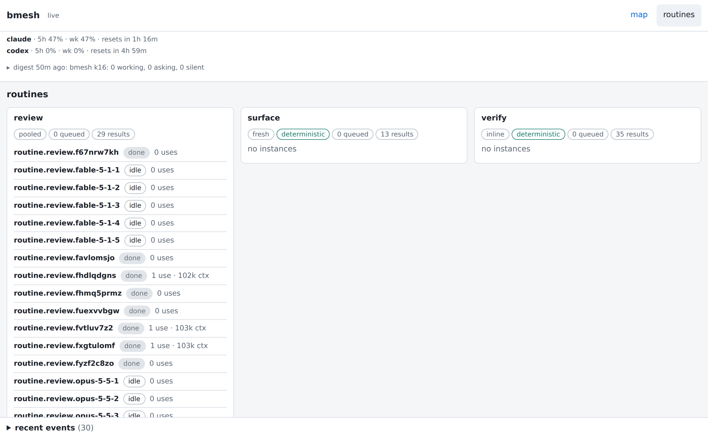

## Opportunity
On this mesh the routine pool is six `review` groups (one per repo) with eighteen instances, and the map draws each as a box. The lead side has thirteen nodes (eight leads and rounds, four engineers, one executor). On the phone the routines section starts 943 px down a 2224 px page and runs longer than the leads, most of it `idle · 0 uses` and `done · 0 uses`:

Eight are `fresh` instances (`routine.review.f<id8>`, README, Modes), each `done` after its one job and kept as a node, so every fresh run adds a permanent grey box. The pooled ones are one per model per repo, idle until a build asks.

The routines page groups the other way (one card per kind, every repo's instances in one list), repeats `routine.review.` on every row, and gives a done fresh instance the same row as a live pooled one:

The two views disagree on what a routine is, and neither answers what the operator asks of a pool: is anything running, is anything queued, what can be retired.

## Proposal
In:
- `/api/tree` lists every defined kind (through `kindDefs`, as `/api/routines` does), each once, with `depth` once per kind and its instances across repos. Today it builds groups from instance nodes only, so `surface` and `verify`, which have none, never appear on the map.
- The map draws one box per defined kind, second line `N queued · N busy · N idle · N spent`, zero counts dropped: queued is the kind's depth, busy the `working` instances, idle the `idle` ones, spent the `done` ones of either mode. A busy count above zero gives the box the `working` pulse. The box links to the routines page. Instances leave the map.
- The routines page keeps one card per kind and groups its instances under an `h4` per repo (the lease list's `leases` heading is the pattern), drops the `routine.<kind>.` prefix from rows (the full path stays in the row's `title`), and folds `done` instances into one row per repo, `spent (8)`, that expands on tap. Order within a repo: `working`, `idle`, then spent.

Out: retiring or removing instances (that is the daemon's and the CLI's job, a `bmesh routine` change the engineer may propose); message edges to instances (a job to `routine.<kind>` lands on the kind box, whose key is `routine.<kind>` already).

Judge: opus, because the result is pinned (counts, grouping, prefix) and the work is reshaping `tree.go` and two renderers with their tests.

## What you'll see
The phone map ends with three short boxes, one per kind, each saying what is queued and running. The routines page reads by kind then repo, rows are the instance's short name, and the eight spent review runs in `party-buzzer-sizing` are one line until opened.

## Verification
The verify commands pass, with `tree_test.go` cases for a defined kind with no instances and for the per-kind depth, and `web_test.go` cases for the `/api/tree` shape. The browser check is the `surface` kind against `?check=1` at 390x844: title `ok`, three kind boxes. README's Routines section says how instances are shown on the map and the page.

## Risks and the alternative considered
Alternatives: (a) one box per kind per repo (today's grouping) with instances folded: still six boxes for one kind; (b) hide idle instances only: the spent ones are the bulk; (c) a routines toggle on the map: hides the queue depth the operator wants when a build waits on a review.

The case that users don't feel it: a single-repo mesh with one pooled instance shows one row and one box either way. The cost is paid by the multi-repo mesh the screenshots show.

## Needs from the operator
