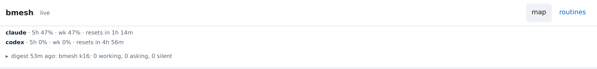

## Opportunity
The strip under the header is the first line of every page, and its third row is the latest digest: `digest 50m ago: bmesh k16: 0 working, 0 asking, 0 silent`. At that moment a round and two engineers were `working` on the same page, seven boxes down and below the fold.

The digest is right for its hour (`[notify] digest_every = "1h"`) and wrong for the page, and it is the only summary line the map has. The badge beside the title says `live`; the line beneath says the opposite of what the tree shows.

## Proposal
In:
- A summary row at the top of the strip, computed from the loaded tree on every render over leads, rounds and their children (not routines, as the digest's title counts): `N working · N asking · N blocked · N silent · N done`, zero counts dropped, words coloured as the badges are. It updates with the live events that restyle nodes. The strip shows whenever the tree has nodes, not only when there is a quota or digest (`renderStrip()` hides it otherwise today).
- The digest keeps its fold below (`▸ digest 50m ago: <title>`), opening to the body as now, so the daemon's hourly wording stays reachable but no longer reads as the present. 013's band, when built, sits under the strip.

Out: changing what the daemon digests or pushes.

Judge: sonnet, because the counts come from data the page holds and the row's layout exists.

## What you'll see
The top of every page says what the mesh is doing now; when a lead asks, `1 asking` appears there within a second, before you find the box.

## Verification
The verify commands pass. The browser check is the `surface` kind against `?check=1` at 1280x800: the title's `strip=` count includes the summary row for a non-empty tree. README's Map paragraph (012) names the summary row.

## Risks and the alternative considered
Alternatives: (a) a shorter digest interval: still stale between runs and a push each time; (b) drop the digest from the strip: loses the hourly body, the one place the daemon's own wording is read. Keeping both, present above past, costs one row.

The case that users don't feel it: an operator who reads the boxes and ignores the strip. The strip sits above the fold on the phone where the boxes do not (012), so it is read first.

## Needs from the operator
