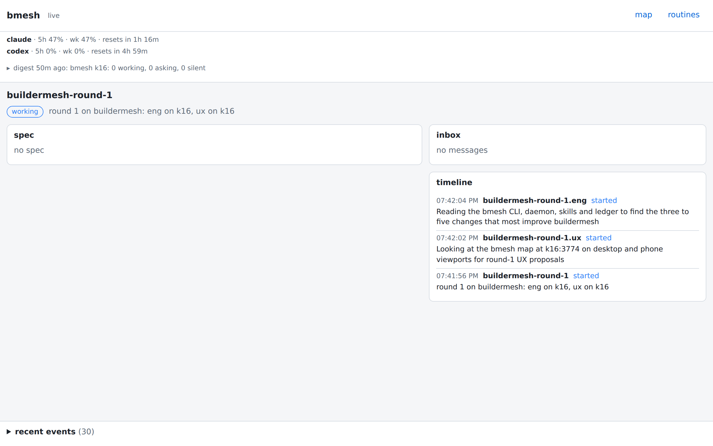
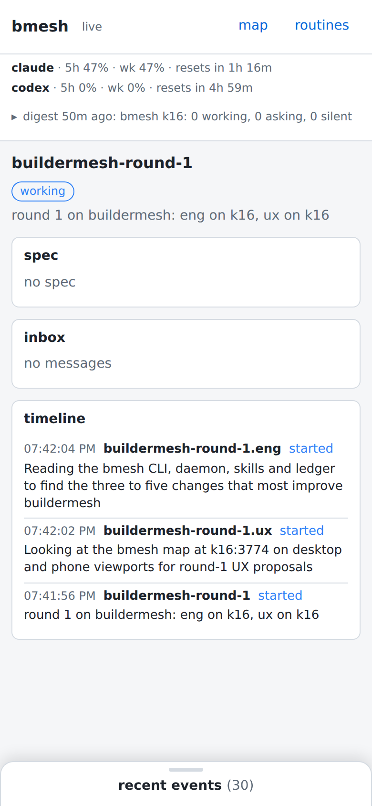

## Opportunity
A round is drawn on the map "like a lead with executors" (README, Proposal rounds), and its page is the lead page. For `buildermesh-round-1` the main column is a card reading `spec` / `no spec`, because a round owns no spec, and nothing on the page says the round has two engineers or what state they are in; their names appear only inside timeline rows.

On the phone the empty spec and inbox cards take the top half of the first screen; the timeline, the one card with content, starts halfway down.

A lead with executors has the same gap: its page shows the spec but not the executors, their states, branches or unread counts, which `bmesh executor list` prints and the map draws.

## Proposal
In:
- `/api/lead/<path>` adds `children: [{node, state, unread}]` (the node's direct children from the same tree `/api/tree` builds) and, for a `round` node, `specs: [{id, title, status, text}]`: the ledger rows on the repo's `origin/main` (the read the lead page already does for a spec) whose `proposed_by` equals a child's `runner.thread`.
- A `tree` card at the top of the main column: one row per child with badge, short name, branch and `N unread`, each row a link to `#/lead/<child path>` (the API serves any node). Absent when there are no children.
- For a round, the spec card becomes `specs`: `NNN title · status` lines, each opening the spec's body in place with the same `specBody` renderer; before any land it reads `no specs landed yet`.
- Empty cards (`no messages`, `no spec`) shrink to one muted line and, on the phone layout, sort after cards with content.

Out: editing or reviewing specs from the page (that is `bmesh spec review` and the chat); executor worktrees on other hosts.

Judge: opus, because the API additions and the ledger read are named here and the work is wiring, not taste.

## What you'll see
A round's page during a round: the two engineers with their states and unread counts, then the specs as they land, then inbox and timeline. A lead's page during a build: its executors, then its spec.

## Verification
The verify commands pass, with `web_test.go` cases for `children` and for a round's `specs` against a fixture ledger. The browser check runs against the branch's own binary (`go run ./cmd/bmesh serve` with a test config on another port, since the daemon on 3774 is the installed `main`) with a headless Chromium script that loads the page at the viewport and prints `document.title` for `?check=1#/lead/<round>` at 390x844: the tree card is the first card. README's lead-page paragraph describes both cards.

## Risks and the alternative considered
Alternatives: (a) a separate round page: a third page type to keep in step; (b) children on the map only: the map already draws them, but the push's `Click` is `<map_url>#/lead/<path>`, the lead page, not the map. The tree card keeps one page type.

The case that users don't feel it: an operator who reads the pitch from the push and never opens the page. The page is the push's click-through, so it is the first thing opened after a push.

## Needs from the operator
